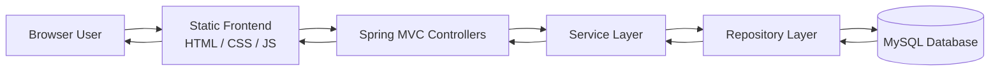
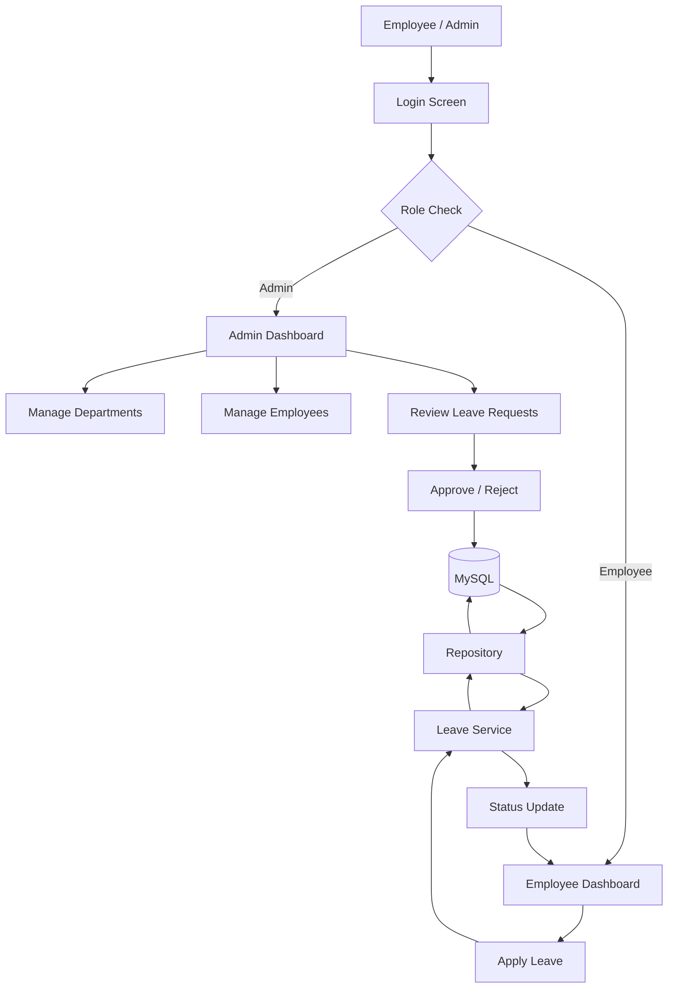

# Employee Management & Leave Tracking System

<p align="center">
  
  
  
  
  
</p>

<div align="center">
  
</div>

<div align="center" style="background: linear-gradient(135deg, #0d1117, #161b22); border:1px solid #30363d; border-radius: 14px; padding: 24px; margin: 20px 0;">
  <h3 style="margin:0; color:#f0f6fc;">A professional HR workflow application for managing employees, departments, and leave approvals.</h3>
  <p style="margin: 10px 0 0; color:#8b949e;">Built with Java, Spring Boot, and MySQL to deliver a secure and scalable employee management experience.</p>
</div>

<p align="center">
  <a href="#quick-start"></a>
  <a href="#api-endpoints"></a>
  <a href="#dashboard-preview"></a>
</p>

## Overview

The Employee Management & Leave Tracking System is a full-stack web application created to simplify HR operations and leave administration in a modern organization. It allows administrators to manage employees, departments, and approval-based leave requests efficiently from a single platform.

### Why this project matters

- centralizes employee records and department data
- reduces manual follow-ups and paperwork
- streamlines leave submission and approval processes
- provides role-based access for admins and employees
- offers a lightweight, practical solution for academic or business demos

### Project at a glance

<table>
  <tr>
    <td><strong>Language</strong></td>
    <td>Java</td>
  </tr>
  <tr>
    <td><strong>Framework</strong></td>
    <td>Spring Boot</td>
  </tr>
  <tr>
    <td><strong>Database</strong></td>
    <td>MySQL</td>
  </tr>
  <tr>
    <td><strong>Frontend</strong></td>
    <td>HTML, CSS, JavaScript</td>
  </tr>
  <tr>
    <td><strong>Architecture</strong></td>
    <td>Layered MVC + Repository Pattern</td>
  </tr>
  <tr>
    <td><strong>Use case</strong></td>
    <td>HR workflow and leave tracking</td>
  </tr>
</table>

## Feature Highlights

### Admin capabilities

- secure admin login
- add, update, and delete employees
- manage departments
- search employees by name or ID
- review all leave requests
- approve or reject leave applications
- access summary dashboard metrics

### Employee capabilities

- employee login
- apply for leave requests
- choose leave type, dates, and reason
- track request status
- view leave history

### Platform capabilities

- responsive user interface
- backend validation and error handling
- JDBC-based data persistence
- scalable architecture for small HR workflows

## System Architecture



## Data Flow



## Dashboard Preview

<div align="center">
  <table>
    <tr>
      <td>
        
      </td>
      <td>
        
      </td>
    </tr>
    <tr>
      <td align="center"><strong>Admin Dashboard</strong></td>
      <td align="center"><strong>Employee Portal</strong></td>
    </tr>
  </table>
</div>

## Tech Stack

| Layer | Technology |
| --- | --- |
| Backend | Java, Spring Boot, Spring MVC |
| Persistence | MySQL, JDBC / JdbcTemplate |
| Frontend | HTML, CSS, JavaScript |
| Build Tool | Maven |
| Runtime | Embedded Tomcat via Spring Boot |
| Configuration | `application.properties` |

## Project Structure

```text
employee-management-leave-tracking-system/
├── .github/
├── src/
│   └── main/
│       ├── java/
│       │   └── com/
│       │       └── employee/
│       │           └── management/
│       │               ├── EmployeeManagementApplication.java
│       │               ├── controller/
│       │               │   ├── AuthController.java
│       │               │   ├── DashboardController.java
│       │               │   ├── DepartmentController.java
│       │               │   ├── EmployeeController.java
│       │               │   └── LeaveController.java
│       │               ├── dto/
│       │               ├── exception/
│       │               ├── model/
│       │               ├── repository/
│       │               │   ├── DepartmentRepository.java
│       │               │   ├── EmployeeRepository.java
│       │               │   ├── LeaveRepository.java
│       │               │   └── UserRepository.java
│       │               └── service/
│       │                   ├── AuthService.java
│       │                   ├── DashboardService.java
│       │                   ├── EmployeeService.java
│       │                   └── LeaveService.java
│       └── resources/
│           ├── application.properties
│           ├── schema.sql
│           └── static/
│               ├── admin.html
│               ├── department.html
│               ├── employee.html
│               ├── index.html
│               ├── css/
│               │   └── styles.css
│               └── js/
│                   └── app.js
├── .gitignore
├── pom.xml
├── README.md
├── PROJECT_REPORT.md
└── database/
    └── schema.sql
```

## Database Design

The project uses MySQL to persist the core application data, including:

- users and roles
- department records
- employee details
- leave request records and statuses

```sql
CREATE TABLE IF NOT EXISTS users (
    id INT PRIMARY KEY AUTO_INCREMENT,
    username VARCHAR(100) NOT NULL UNIQUE,
    password VARCHAR(255) NOT NULL,
    role VARCHAR(20) NOT NULL
);

CREATE TABLE IF NOT EXISTS departments (
    id INT PRIMARY KEY AUTO_INCREMENT,
    department_name VARCHAR(100) NOT NULL UNIQUE
);

CREATE TABLE IF NOT EXISTS employees (
    id INT PRIMARY KEY AUTO_INCREMENT,
    name VARCHAR(100) NOT NULL,
    email VARCHAR(150) NOT NULL UNIQUE,
    phone VARCHAR(20),
    department_id INT,
    salary DOUBLE,
    created_at TIMESTAMP DEFAULT CURRENT_TIMESTAMP,
    updated_at TIMESTAMP DEFAULT CURRENT_TIMESTAMP ON UPDATE CURRENT_TIMESTAMP,
    FOREIGN KEY (department_id) REFERENCES departments(id)
);

CREATE TABLE IF NOT EXISTS leave_requests (
    id INT PRIMARY KEY AUTO_INCREMENT,
    employee_id INT NOT NULL,
    leave_type VARCHAR(50) NOT NULL,
    start_date DATE NOT NULL,
    end_date DATE NOT NULL,
    status VARCHAR(20) DEFAULT 'PENDING',
    reason VARCHAR(255),
    applied_on TIMESTAMP DEFAULT CURRENT_TIMESTAMP,
    FOREIGN KEY (employee_id) REFERENCES employees(id)
);
```

## API Endpoints

The backend exposes REST APIs under the `/api` base path.

| Method | Endpoint | Description |
| --- | --- | --- |
| POST | `/api/auth/login` | Authenticate a user and return role and login status |
| GET | `/api/dashboard` | Fetch admin dashboard summary data |
| GET | `/api/departments` | List all departments |
| POST | `/api/departments` | Create a new department |
| GET | `/api/employees` | Get all employees |
| POST | `/api/employees` | Add a new employee |
| GET | `/api/employees/{id}` | Fetch one employee by ID |
| PUT | `/api/employees/{id}` | Update an employee record |
| DELETE | `/api/employees/{id}` | Delete an employee |
| GET | `/api/employees/search?keyword=...` | Search employees by keyword |
| GET | `/api/leaves` | Get all leave requests |
| POST | `/api/leaves` | Apply for leave |
| GET | `/api/leaves/{id}` | Get leave request by ID |
| GET | `/api/employees/{employeeId}/leaves` | Get all leave requests for an employee |
| PUT | `/api/leaves/{id}/status?status=APPROVED` | Update leave request status |
| DELETE | `/api/leaves/{id}` | Delete leave request |

### Example login request

```json
{
  "username": "admin",
  "password": "admin123"
}
```

### Example login response

```json
{
  "success": true,
  "message": "Login successful",
  "role": "ADMIN",
  "username": "admin"
}
```

## Prerequisites

Before running this project, make sure you have:

- Java 17 or newer
- Maven installed
- MySQL Server running locally
- a MySQL database named `employee_management`

## Quick Start

### 1) Clone the repository

```bash
git clone https://github.com/mohddilshadkhan2003/employee-management-leave-tracking-system.git
cd employee-management-leave-tracking-system
```

### 2) Create the database

```sql
CREATE DATABASE employee_management;
```

### 3) Configure MySQL connection

Open `src/main/resources/application.properties` and update the database details:

```properties
spring.application.name=employee-management-leave-tracking-system
server.port=8080

spring.datasource.url=jdbc:mysql://localhost:3306/employee_management?useSSL=false&allowPublicKeyRetrieval=true&serverTimezone=UTC
spring.datasource.username=root
spring.datasource.password=root
spring.datasource.driver-class-name=com.mysql.cj.jdbc.Driver

spring.datasource.hikari.maximum-pool-size=10
spring.datasource.hikari.minimum-idle=2
spring.sql.init.mode=always
```

### 4) Build and run the application

```bash
mvn clean install
mvn spring-boot:run
```

### 5) Open in browser

```text
http://localhost:8080
```

## Run on Your System (Step-by-Step)

### Windows

1. Install Java JDK 17+
2. Install Maven and add it to `PATH`
3. Install MySQL and start the service
4. Open MySQL Workbench or terminal and create the database:

```sql
CREATE DATABASE employee_management;
```

5. Update `application.properties` with your username and password
6. Run:

```bash
cd path\to\employee-management-leave-tracking-system
mvn clean install
mvn spring-boot:run
```

7. Visit `http://localhost:8080`

### macOS / Linux

```bash
sudo apt update
sudo apt install openjdk-17-jdk maven mysql-server
mysql -u root -p
CREATE DATABASE employee_management;
```

Then run:

```bash
git clone https://github.com/mohddilshadkhan2003/employee-management-leave-tracking-system.git
cd employee-management-leave-tracking-system
mvn clean install
mvn spring-boot:run
```

Open:

```text
http://localhost:8080
```

## Default Admin Login

```text
Username: admin
Password: admin123
```

## Typical Workflow

### Employee workflow

1. login as employee
2. submit leave request
3. select leave type, dates, and reason
4. wait for admin approval
5. view updated leave status

### Admin workflow

1. login as admin
2. manage departments
3. add or update employees
4. review leave requests
5. approve or reject requests
6. monitor dashboard data

## Project Status

This project is a working HR and leave management solution suitable for:

- academic projects
- internship demos
- small business prototypes
- portfolio showcases

## Developer

Developed by: Mohd Dilshad Khan

---

<p align="center">
  
  
  
  
</p>
