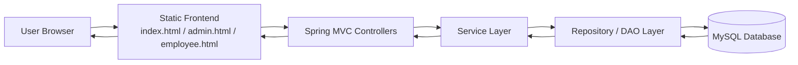
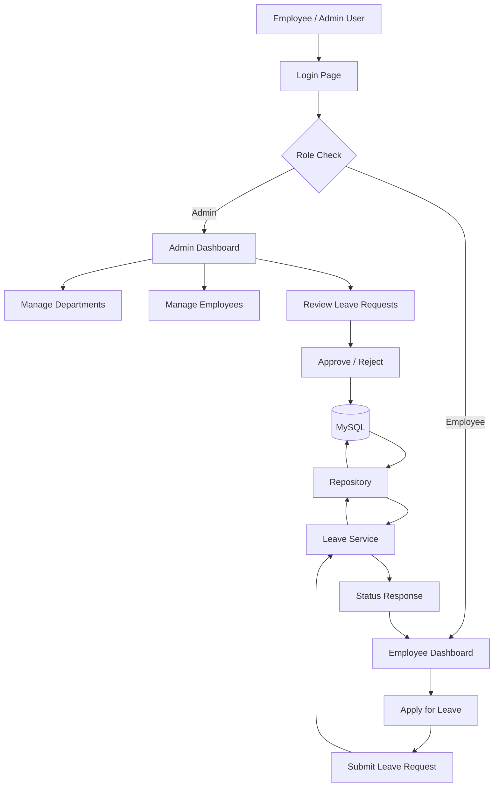
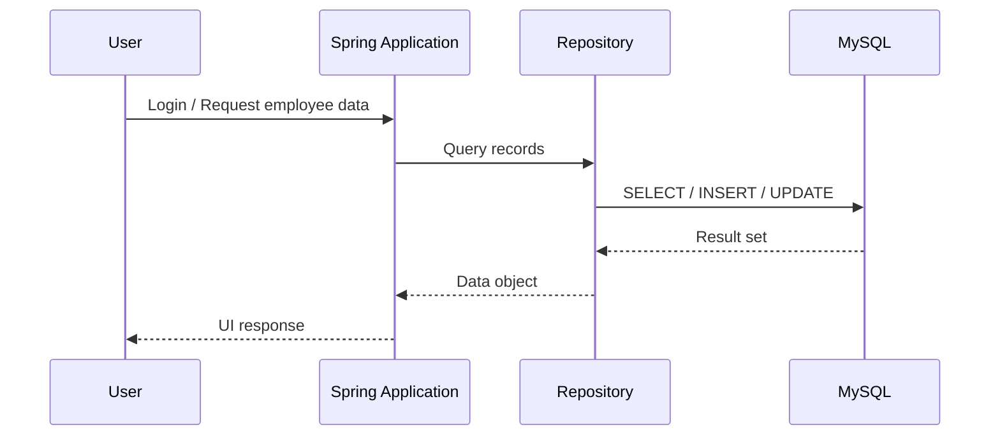

# Employee Management & Leave Tracking System

<p align="center">
  
  
  
  
  
</p>

A full-stack employee management and leave tracking system designed to streamline HR workflows, automate leave approvals, and centralize employee data in a simple, secure web application.

This project combines Java, Spring Boot, MySQL, and a responsive web UI to deliver a practical business-oriented solution for employee administration and leave management.

## Table of Contents

- [Overview](#overview)
- [Architecture](#architecture)
- [Data Flow](#data-flow)
- [Key Features](#key-features)
- [Project Structure](#project-structure)
- [Technology Stack](#technology-stack)
- [Database Design](#database-design)
- [Prerequisites](#prerequisites)
- [Installation](#installation)
- [Run the Application](#run-the-application)
- [Default Login](#default-login)
- [Workflow](#workflow)
- [Project Status](#project-status)
- [Developer](#developer)

## Overview

The system provides a complete digital workflow for managing:

- employee records
- department information
- leave application requests
- leave approval/rejection decisions
- role-based access for admin and employee users
- dashboard summaries and operational insights

It is particularly useful for academic projects, internal company demos, and small-scale HR management scenarios where a lightweight, web-based system is needed.

## Architecture

The application follows a layered architecture with a clean separation between presentation, business logic, and persistence layers.



### Layer responsibilities

- Frontend: HTML, CSS, JavaScript pages served from `src/main/resources/static`
- Controller Layer: Handles HTTP requests, routing, and validation
- Service Layer: Implements business logic for employees, departments, and leave workflows
- Repository Layer: Executes database operations using JDBC/JdbcTemplate
- Database: Stores employee details, department records, and leave records

## Data Flow



This flow ensures that all user actions—login, leave submission, approval, and record updates—are processed through the application layer and persisted consistently in the database.

## Key Features

### Admin Features

- Admin login and role-based access
- Add employees
- Update and remove employee records
- Manage departments
- View employee directories and details
- Review leave requests
- Approve or reject leave applications
- Dashboard-based summary statistics

### Employee Features

- Employee login
- Submit leave requests
- Choose leave type and date range
- Provide leave reason
- View leave history and current status
- Track approval outcomes

### General Features

- Java-based backend using Spring Boot
- MySQL persistence layer
- Responsive front-end interface
- Form validation and business checks
- Role-aware workflow for HR and employees
- Lightweight architecture for demo and academic use

## Project Structure

```text
employee-management-leave-tracking-system/
├── .github/
├── src/
│   └── main/
│       ├── java/
│       │   └── com/
│       │       └── employee/
│       │           └── management/
│       │               ├── EmployeeManagementApplication.java
│       │               ├── controller/
│       │               │   ├── AuthController.java
│       │               │   ├── DashboardController.java
│       │               │   ├── DepartmentController.java
│       │               │   ├── EmployeeController.java
│       │               │   └── LeaveController.java
│       │               ├── dto/
│       │               ├── exception/
│       │               ├── model/
│       │               ├── repository/
│       │               │   ├── DepartmentRepository.java
│       │               │   ├── EmployeeRepository.java
│       │               │   ├── LeaveRepository.java
│       │               │   └── UserRepository.java
│       │               └── service/
│       │                   ├── AuthService.java
│       │                   ├── DashboardService.java
│       │                   ├── EmployeeService.java
│       │                   └── LeaveService.java
│       └── resources/
│           ├── application.properties
│           ├── schema.sql
│           └── static/
│               ├── admin.html
│               ├── department.html
│               ├── employee.html
│               ├── index.html
│               ├── css/
│               │   └── styles.css
│               └── js/
│                   └── app.js
├── .gitignore
├── pom.xml
├── README.md
├── PROJECT_REPORT.md
└── database/
    └── schema.sql
```

## Technology Stack

| Layer | Technologies |
| --- | --- |
| Backend | Java, Spring Boot, Spring MVC |
| Persistence | MySQL, JDBC / JdbcTemplate |
| Frontend | HTML, CSS, JavaScript |
| Build Tool | Maven |
| Configuration | `application.properties` |
| Runtime | Java JDK, Tomcat embedded in Spring Boot |

## Database Design

The system stores core business data in MySQL, including:

- employees
- departments
- users / login credentials
- leave requests
- leave statuses and metadata

A typical data lifecycle is:



## Prerequisites

Before running the application, ensure that you have:

- Java JDK 17 or newer
- Maven installed
- MySQL Server installed and running
- A database named `employee_management`

## Installation

1. Clone the repository

```bash
git clone https://github.com/mohddilshadkhan2003/employee-management-leave-tracking-system.git
cd employee-management-leave-tracking-system
```

2. Create the database in MySQL

```sql
CREATE DATABASE employee_management;
```

3. Update database credentials in `src/main/resources/application.properties`

```properties
spring.application.name=employee-management-leave-tracking-system
server.port=8080

spring.datasource.url=jdbc:mysql://localhost:3306/employee_management?useSSL=false&allowPublicKeyRetrieval=true&serverTimezone=UTC
spring.datasource.username=root
spring.datasource.password=root
spring.datasource.driver-class-name=com.mysql.cj.jdbc.Driver
```

4. Ensure SQL initialization is enabled if you want schema scripts to run automatically

```properties
spring.sql.init.mode=always
```

## Run the Application

Run the project with Maven:

```bash
mvn clean install
mvn spring-boot:run
```

After startup, open the app in your browser:

```text
http://localhost:8080
```

## Default Login

```text
Username: admin
Password: admin123
```

## Workflow

### Employee Lifecycle

1. Employee logs in
2. Employee submits leave request with dates and reason
3. Request is stored in the database
4. Admin reviews request
5. Admin approves or rejects the request
6. Employee sees updated leave status

### Admin Lifecycle

1. Admin logs in
2. Admin adds or updates employee records
3. Admin manages departments
4. Admin evaluates leave applications
5. Admin monitors dashboard metrics

## Project Status

This project is a functional HR and leave management demo built with a layered Spring Boot architecture and MySQL persistence. It is suitable for:

- academic projects
- internship portfolios
- small business prototypes
- HR workflow demonstrations

## Developer

Developed by: Mohd Dilshad Khan

---

If you want, I can also create a more visually polished version with:

- a custom banner image section
- a dark mode theme
- GitHub profile badges
- screenshots placeholders for admin and employee pages
- a dedicated API documentation section
